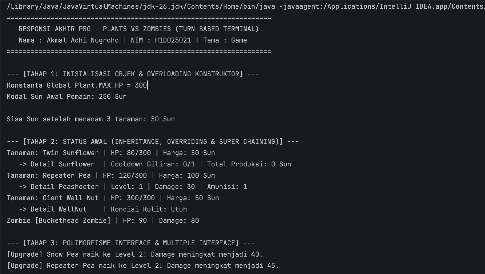
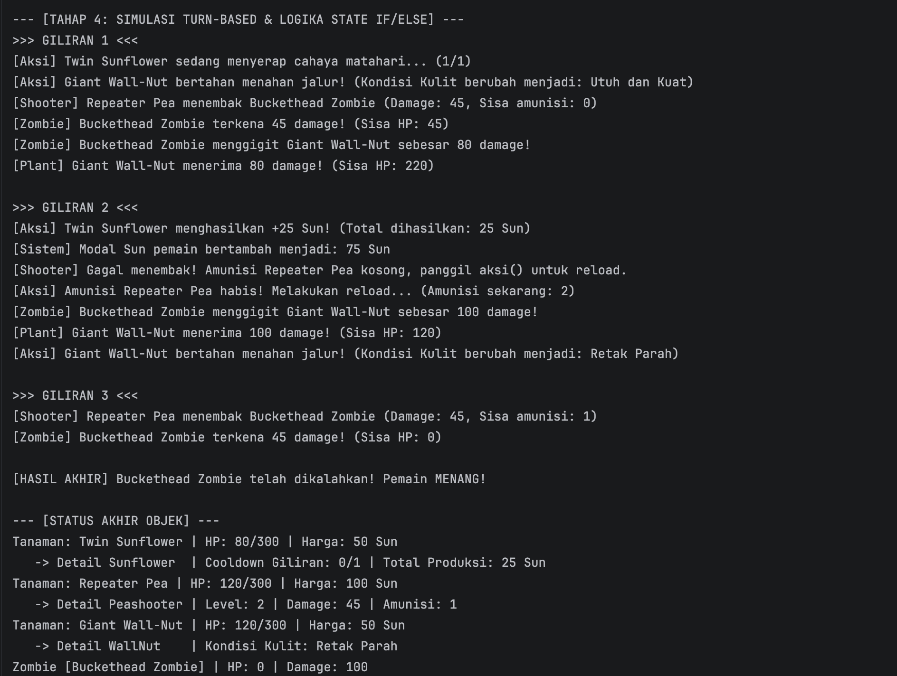

# Responsi Akhir Praktikum Pemrograman Berorientasi Objek (PBO)
## Plants vs Zombies (Turn-Based Terminal Edition)

### 1. Identitas Mahasiswa & Tema
* **Nama:** Akmal Adhi Nugroho
* **NIM:** H1D025021
* **Shift KRS:** D
* **Digit Terakhir NIM:** 1
* **Tema Sistem:** Game (Plants vs Zombies Turn-Based)

---

### 2. Daftar Pemenuhan 10 Persyaratan Teknis PBO
1. **State dan Behavior:** Memiliki atribut `hp`, `hargaSun`, `damage`, method prosedur `void terimaDamage(int dmg)`, dan method fungsi `boolean isMati()` pada class objek.
2. **Immutability:** Terdapat konstanta global `public static final int MAX_HP = 300` dan atribut instans kekal `private final String nama` (tanpa setter) pada abstract class `Plant`.
3. **Enkapsulasi dan Overloading:** Seluruh atribut berstatus `private` dengan getter & setter serta keyword `this`. Masing-masing class memiliki minimal dua variasi konstruktor (*overloaded constructor*).
4. **Inheritance:** Class `Peashooter`, `Sunflower`, dan `WallNut` mewarisi (*extends*) abstract class `Plant`. Class `Main` dipisahkan dari class lainnya.
5. **Super Chaining:** Pemanggilan `super(...)` pada konstruktor subclass dan pemanggilan `super.info()` di dalam method overriding.
6. **Method Overriding:** Penimpaan method `info()` dan `aksi()` dari superclass pada seluruh subclass menggunakan anotasi `@Override`.
7. **Abstract Class:** Class `Plant` berstatus `abstract` dan memiliki abstract method `public abstract void aksi();`.
8. **Logika State Percabangan (`if/else`):** Implementasi abstract method `aksi()` memuat logika percabangan untuk membaca dan mengubah state internal objek (seperti reload amunisi `Peashooter`, cooldown produksi sun `Sunflower`, dan perubahan kondisi kulit `WallNut` berdasarkan sisa HP).
9. **Polimorfisme Interface:** Pemanggilan method objek melalui variabel referensi bertipe interface (contoh: `Shooter penembakUtama = peashooter;` dan `Upgradeable tanamanUpgrade = new Peashooter("Snow Pea");`).
10. **Multiple Interface:** Class `Peashooter` mengimplementasikan dua interface sekaligus (`implements Shooter, Upgradeable`).

---

### 3. Petunjuk Compile dan Run Melalui Terminal

Pastikan perangkat Anda telah terinstal JDK (Java Development Kit). Buka terminal (atau terminal bawaan di IntelliJ IDEA) dan arahkan ke direktori `src` project:

```bash
# 1. Masuk ke direktori src
cd src

# 2. Compile seluruh file sumber Java
javac *.java

# 3. Jalankan program utama
java Main

# 4. Screenshot Luaran Program





